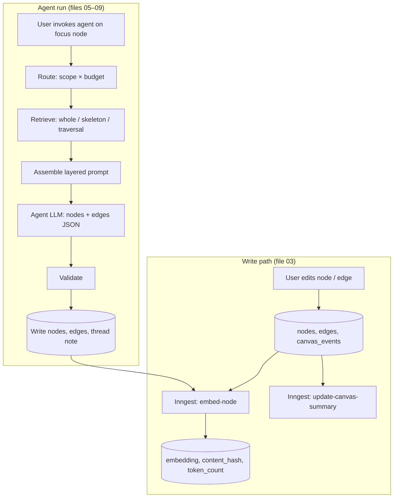

# 01 — Overview and Principles

## The problem

ThinkingCanvas is a spatial thinking tool. Users build canvases of nodes connected by typed,
labeled edges. AI agents (expander, stress tester, synthesizer, structurer, critic/provoker) act
on a **focus node** to produce new nodes and edges.

When a canvas is small, the whole thing fits in a prompt and the agent understands it. As it
grows:

- The full canvas no longer fits the token budget, or costs too much per call.
- Even when it fits, models reason worse over long, flat context, and unrelated nodes distract.
- Relationships between ideas (which the user encoded as edges) get lost when nodes are sent as a
  flat list.

The goal is to give each agent **the context the task needs, in a form that preserves structure,
without missing anything essential**, at a cost that stays flat as canvases grow.

## Product context the agent should keep in mind

- ThinkingCanvas is the flagship of a company focused on **augmenting human thinking, not
  replacing it**. AI output should externalize and provoke the user's thinking, and the user
  stays in control of their own structure (hence suggested edges, P9).
- Agents map to distinct **cognitive stances** (synthesizer, critic/provoker, structurer;
  expander and stress tester were added in this design). That is why each has its own edge
  policy (file 07).
- Threads are **canvas-scoped and persistent**: thinking is cumulative, so thread notes carry
  what agents already contributed (file 08).
- AI responses render as **canvas structures, not text**. Jev already picks the shape
  (hierarchy / sequence templates); users can freely rearrange nodes afterwards.
- The frontend writes simple mutations directly to Supabase; logic-heavy work goes through the
  backend.

## Goals

1. **Recall first.** Never miss a node the task genuinely needs. Including an extra title is
   cheap; missing a needed node produces a bad answer.
2. **Spend context in proportion to the task.** A "reframe this" request should not pay for the
   whole canvas.
3. **Preserve structure.** The agent should see how ideas connect (edge types and the user's
   stated reasons), not just what they say.
4. **Flat cost at scale.** Per-call cost should not grow linearly with canvas size.
5. **Agent output lands as canvas structure** (nodes + edges), never as free prose.
6. **Log everything** needed to evaluate and later improve retrieval (and eventually fine-tune).

## Principles (the bets this design makes)

These are the reasons behind every mechanism in later files. If an implementation choice
conflicts with one of these, the principle wins.

### P1. A node's meaning lives partly in its neighborhood
Canvas nodes are fragments ("Yes, but only for enterprise"), not documents. A node is
interpretable only with its parent, siblings, and the reasons on its edges.
→ The focus node is **never** sent without its 1-hop neighborhood (file 05, Scope S1).

### P2. User-drawn edges are the strongest relevance signal
An edge is the user explicitly stating "these relate, and here is why". The edge label (the
user's reason) is often the most valuable context available.
→ Edges and labels are always serialized inline (file 08). Edge types drive traversal (file 07).

### P3. Similarity and structure fail in opposite ways
- Embeddings miss nodes that are *related but worded differently*: parents, counterpoints,
  grandparent framing questions.
- Graph structure misses nodes that are *related but never linked*.
→ Use structure as the backbone, embeddings as an extra net for unlinked nodes (file 06).

### P4. Relevance decays with distance — but not uniformly
Most useful context sits within ~2 hops. Beyond that, relevance must be *earned* (decided
per-edge), not assumed.
→ Hops 1–2 are cheap and largely unconditional; deeper hops are Jev-guided (file 06).

### P5. Decide the task's scope, not the context's sufficiency
A model cannot judge whether context is sufficient without seeing what's missing ("unknown
unknowns"). It *can* judge what a task inherently needs to look at.
→ Routing classifies **task scope** up front (file 05), rather than looping "is this enough?".

### P6. Degrade before you drop
When the budget is tight, reduce detail (full text → title → stub) before removing a node.
A stub still lets the agent see the node exists and fetch it.
→ Detail tiers and the `expand_context` tool (files 06, 08).

### P7. No retrieval beats good retrieval when everything fits
If the whole canvas fits the budget and the task needs breadth, send the whole canvas.
→ Budget categories (file 05).

### P8. Code does the walking, models do the judging
Graph traversal, token counting, validation, and layout are deterministic code. Models are used
only for judgment: Jev for fast typed decisions, the agent LLM for generation.

### P9. The AI should not silently rewrite the user's structure
Agent edges that connect into the user's existing nodes are stored as **suggested** until the
user accepts them (file 09).

## Non-goals [DECIDED]

- **No cluster summaries.** No per-cluster or per-region summaries, and no community detection.
  (A single *canvas-level* rolling summary is in scope — file 04.)
- **No spatial reasoning or spatial-nearby retrieval.** Node x/y positions are stored for the UI
  but are **not** used for retrieval, scoring, or prompts. Agents never output coordinates.
- **No custom model training now.** Fine-tuning is a possible future use of the logged data,
  not part of this work.
- **No classic (Microsoft-style) GraphRAG entity extraction.** The canvas already is a graph;
  there is nothing to extract.

## Shape of the system

