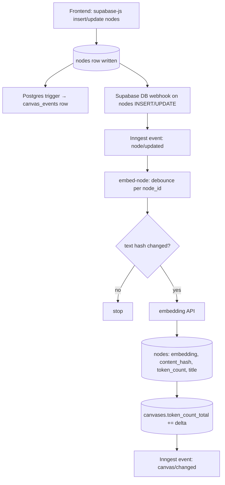

# 03 — Write Path

Everything that happens when a node or edge is created or changed, so that retrieval later has
embeddings, token counts, and recent-activity data ready. All work after the initial DB write is
async (Inngest). The user never waits on it.

## 3.1 Node created or text edited [DECIDED]

### Steps

1. **Frontend** writes the node via `supabase-js` (existing behavior).
2. **Postgres trigger** inserts a `canvas_events` row — only if `text` changed or the row is new
   (not for x/y-only changes).
3. **Supabase DB webhook** on `nodes` INSERT/UPDATE sends `node/updated {node_id, canvas_id}` to
   Inngest (directly to an Inngest webhook source, or via a thin backend relay — use whichever
   the repo already does).
4. **Inngest function `embed-node`**
   - **Debounce** ~3 s keyed by `node_id` [PLACEHOLDER]. Typing produces one job, not fifty.
   - **Read** `nodes` (text, content_hash, token_count).
   - Compute `hash(text)`. If equal to `content_hash` → **stop**. (Moves/resizes end here.)
   - **Call** the embedding API with the node text.
   - Compute `token_count` (approximate tokenizer OK) and derived `title` if needed.
   - **Write** `nodes.embedding`, `content_hash`, `token_count`, `title`.
   - **Write** `canvases.token_count_total += (new_token_count - old_token_count)`.
     Use an atomic SQL update, not read-modify-write in application code.
   - **Emit** `canvas/changed {canvas_id}` (consumed by the summary job, file 04).

### Rules
- The query embedding at agent time (file 06) **must use the same embedding model** as node
  embeddings. Store the model name in config; if it ever changes, re-embed all nodes.
- Agent-created nodes go through **exactly the same path** (they are inserted by the agent run,
  which fires the same webhook). This makes agent output retrievable in later runs.
- Node deletion: the webhook on DELETE decrements `token_count_total` and logs an event.
  Edges referencing the node are removed by FK cascade.

## 3.2 Edge created, edited, or deleted [DECIDED]

1. **Frontend** writes `edges` via `supabase-js` with `type` (required), `label` (optional),
   `origin = user`, `status = accepted`.
2. **Postgres trigger** writes a `canvas_events` row.
3. No embedding is needed for edges [PROPOSED]. Edge label tokens count toward
   `canvases.token_count_total` (update in the trigger or a small Inngest job).
4. Emit `canvas/changed` so the summary job can account for structural changes.

*Optional later:* embed edge labels so users/agents can search over reasons ("where did I argue
about churn?"). [DEFERRED]

## 3.3 User reviews agent-suggested edges

- Accept → `update edges set status = 'accepted'`. Accepted edges are included in future
  traversals.
- Reject → `update edges set status = 'rejected'` (keep the row; it is a training signal) or
  delete. Record the outcome on the originating `agent_runs.outcome`.

## 3.4 Implicit edges [DEFERRED — lower priority now that users draw typed edges]

Originally proposed to connect related-but-unlinked nodes at write time:
- pgvector: top-5 similar nodes in the same canvas above a similarity floor.
- Jev, per candidate pair: a 3-level `Score` (unrelated / maybe related / clearly related) plus a
  `Choice` for relation type (pattern from TypeSafe's entity-alignment cookbook, file 10).
- Write as `origin = implicit`, `status = suggested`.

Because users now draw typed, labeled edges, this is only needed if evals (file 12) show
traversal missing unlinked-but-related nodes that the semantic seeds also miss. Do not build
until then.

## 3.5 What is NOT done on the write path [DECIDED]

- No cluster detection, no cluster summaries.
- No spatial neighbor computation.
- x/y changes trigger the webhook (because the row updates) but stop at the hash check.
